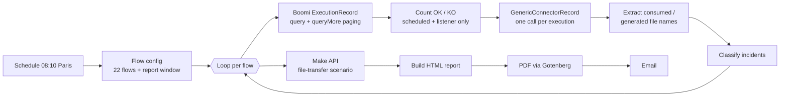
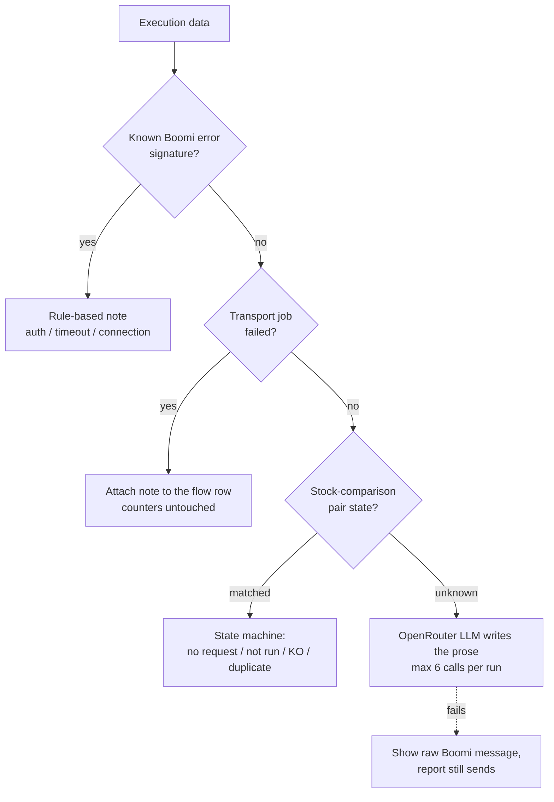

# Boomi Daily Monitoring — n8n automation

> Internship project at **OliveSoft** (Jun – Aug 2026), AI Automation Intern.
> This is a case study. The production workflow and client data stay with OliveSoft; the code in
> `demo/` is a clean re-implementation of the core rules with made-up flows.

An operations engineer wrote a daily email for a luxury-fashion client summarising **22 production
integration flows** running on Boomi AtomSphere (ERP ⇄ logistics partners in China and Japan): how many
executions ran, which failed, which files moved, and what each incident meant for the business.
It took up to **two hours every morning**.

I replaced it with an **n8n workflow** that queries the Boomi and Make APIs, rebuilds the exact same
report, and sends it — validated row-for-row against the real emails.

## Results

| Check | Result |
| --- | --- |
| 1-day window | 22/22 rows, 0 count mismatches |
| 2-day window after a French public holiday | 22/22 rows, 0 mismatches |
| Monday window (Fri → Mon) | 22/22 rows, 0 mismatches, **identical file lists** |
| Make scenario file counts | 3 independent emails reproduced (13, 39, 43) |
| Real incidents | SFTP timeout, refused credentials, failed transport job, recovery — all detected |

- **27,897 execution records** across **34 Boomi processes** pulled and analysed
- Daily manual review cut by **up to two hours**
- Found that 3 processes failed **in the same second** on one shared SFTP host — every flow
  fires on the hour, so staggering schedules by a few minutes should reduce errors

## How it works



### Incident detection — deterministic first, LLM last



**The model never decides a count, an icon or a classification.** Code does. The LLM only writes
wording for error signatures nobody has seen before, and the report goes out even if it fails.

## Business rules that mattered

- **Report window** is computed in Europe/Paris (handles daylight saving), not a fixed UTC offset.
- **One calendar rule** covers everything: `daysBack = 1 + every non-report day before today`.
  Monday covering Fri→Mon and the day after a French holiday both fall out of it.
- **Status icons:** ☀ all good · ⛅ failed then recovered · ❌ failed, no recovery · ⚠ scheduled run missing.
- **A process name is not a unique key** — two processes shared one name, so matching uses `processId`.

## Lessons from the APIs

- Boomi returns 100 records per page; paging uses `queryToken` + `queryMore` with `Content-Type: text/plain`.
- GenericConnectorRecord accepts **one** `executionId` per call — batched filters return 400.
- Without an `atomName` filter, DEV executions silently double the PROD counts.
- Boomi keeps ~30 days of history; older windows come back empty, not as an error.
- Make expects `Authorization: Token <key>`, not `Bearer`, and its log timestamp is the run **start**.
- An n8n node set to *continue on error* stays green when the call fails — read the output.

## What I'd do next

- Move it off a workstation to a permanent host: if the machine is off at 08:10, silence looks like success.
- Add a heartbeat alarm for "the workflow never started", not only "the workflow failed".

## Demo

`demo/` holds a dependency-free re-implementation of the window calculation and the icon logic,
with tests:

```bash
node --test   # Node 18+, no install needed
```

## Stack

n8n · Boomi AtomSphere API · Make API · JavaScript · Postman · Docker · Gotenberg · OpenRouter

---

Mohamed Adam Ghorbel — [portfolio](https://ademghorbel.github.io/MAG/) ·
[LinkedIn](https://www.linkedin.com/in/mohamed-adam-ghorbel/)
